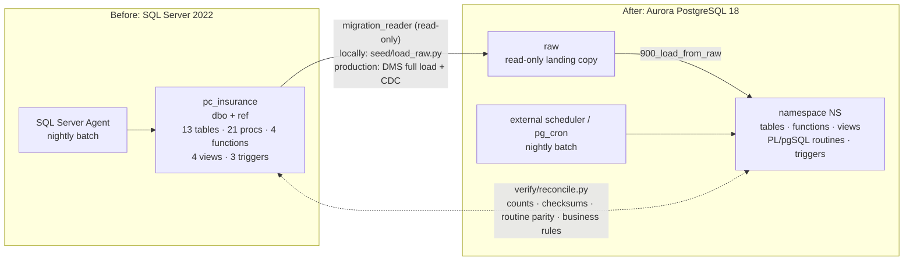

# uc-db-migration-sqlserver-to-postgres

A migration lab for a synthetic European P&C insurer, with TCS as the delivery partner. It moves a **SQL Server 2022** T-SQL back office to **PostgreSQL 18** (Amazon Aurora PostgreSQL-compatible), and a reconciliation harness proves parity object by object.

`main` is the starting point for a live demo. The schema, functions, views and CRUD procedures (Phase 1) are converted. Rating, claims, reporting, batch and triggers (Phase 2) are still T-SQL only, and reconcile reports them as **NOT CONVERTED**. Devin converts them live until the report goes green. The branch `rehearsal/phase2` holds the finished answer.

## Before → after



## Quick start

Prerequisites: Docker, Python 3.10+, Microsoft ODBC Driver 18 for SQL Server, `make`.

```bash
make install            # pip install -r requirements.txt + pre-commit install
make docker-up          # SQL Server 2022 Express :1433, PostgreSQL 18.6 :55432
make seed               # deploy legacy estate, load deterministic synthetic data, copy to PostgreSQL raw
make build NS=dev       # build namespace dev from migrations/
make reconcile NS=dev   # -> work/reconcile/report.md ; exits 1 on any FAIL
make functional NS=dev  # create policy -> endorse -> pay -> open claim -> close claim, on both engines
make reconcile-naive    # a plausible but wrong conversion; expected to FAIL
make batch NS=dev       # legacy nightly batch (rolled back unless COMMIT=1)
make coverage lint      # 38/38 T-SQL constructs present; sqlfluff, ruff, yamllint
make help               # every target
```

Expected on `main`: `dev: PASS 33, FAIL 0, NOT CONVERTED 18`. With the naive conversion: `PASS 33, FAIL 1, NOT CONVERTED 17`.

## What's here

| Path | Contents |
|---|---|
| `source/sqlserver/` | The legacy estate: 13 tables, 2 sequences, 21 procedures (CRUD, rating, claims, reporting, batch), 3 scalar functions + 1 inline TVF, 4 views, 3 audit triggers |
| `seed/` | Deploy the estate, deterministic data generator (fixed seed, ~2k policyholders, 5k policies, ~20k premium payments, 1.5k claims, hand-written edge rows), read-only `migration_reader` login, raw loader, namespace builder, batch runner |
| `migrations/` | PostgreSQL target, numbered SQL with a `$(NS)` placeholder |
| `naive_conversion/` | A deliberately wrong conversion, a fixture for `make reconcile-naive` |
| `verify/` | Reconcile harness, controls (fixed inputs per object), normalisation rules, functional test, construct coverage |
| `infra/terraform/` | Aurora PostgreSQL 18 cluster sketch, Secrets Manager master credentials. `terraform validate` only |
| `docs/` | [Migration map](docs/SQLSERVER_TO_POSTGRES_MIGRATION_MAP.md) · [Construct map](docs/CONSTRUCT_MAP.md) · [Conversion playbook](docs/CONVERSION_PLAYBOOK.md) · [Demo runbook](docs/DEMO_RUNBOOK.md) · [Lab](docs/LAB.md) · [Cutover](docs/CUTOVER.md) · [AWS SCT comparison](docs/AWS_SCT_COMPARISON.md) |
| `AGENTS.md`, `.agents/skills/sqlserver-pg-reconcile/` | Instructions and a skill for coding agents converting objects here |

## Reconciliation

`verify/reconcile.py --ns <ns>` compares the local SQL Server with a PostgreSQL namespace:

- **Tables**: `COUNT(*)` and an ordered checksum for each column, after documented normalisation. NULL stays distinct from `''`. Strings are NFC with case and whitespace kept. Numerics are compared at 6 dp, timestamps at ms in UTC, UUIDs in lower case.
- **Sequences**: next value is past every loaded key.
- **Functions, views, procedures, triggers**: run on fixed inputs (case variants, 29 February, month ends, half cents, NULL/empty, error paths, multi-row DML) on both engines. The harness compares result sets, error text and the resulting table state. Write cases run in a transaction that is rolled back.
- **Business rules**: premium schedule adds up to the annual premium, reserve ≥ paid per reserve type, premium control totals, loss ratio by product.
- An object with no PostgreSQL counterpart is **NOT CONVERTED**, never PASS. Any FAIL exits non-zero. `--mode test` is the CI profile.

## Engines and licences

| Engine | Image | Licence | Notes |
|---|---|---|---|
| SQL Server 2022 **Express** | `mcr.microsoft.com/mssql/server:2022-latest`, `MSSQL_PID=Express` | Free Microsoft EULA, production use allowed | 10 GB per database, 1 socket / up to 4 cores, ~1.4 GB buffer pool, **no SQL Server Agent** (the nightly batch runs from `make batch`), no CDC capture jobs. Real SQL Server behaviour, unlike an emulator |
| PostgreSQL **18.6** | `postgres:18.6` | PostgreSQL Licence (permissive) | Same major/minor as the Aurora PostgreSQL 18.6 target. Volume mounted at `/var/lib/postgresql`, the PG18 image layout |

Babelfish for Aurora PostgreSQL is an alternative that runs T-SQL over TDS. It is not used here, because the goal is native PostgreSQL.

## Migration tooling choice

Numbered plain-SQL files applied by a ~60-line runner (`seed/deploy.py`), not Flyway or Liquibase:

- Every build creates a **throwaway namespace** (`NS=dev`, `NS=live`, `NS=naive`, one per branch or person) by replacing `$(NS)`. Flyway's schema history table is designed for long-lived databases that only move forward. Here each namespace is rebuilt from scratch in seconds and dropped afterwards.
- There's no JVM and no extra container, so CI and a fresh Devin session only need Python.
- Overlays (`--overlay naive_conversion`) replace same-named files, which is how the naive conversion is injected without touching `migrations/`.
- For production, the same files can be handed to Flyway unchanged (`V001__extensions.sql` …) with `$(NS)` mapped to a Flyway placeholder.

## Aurora compatibility

- Target version 18.6, which matches an Aurora PostgreSQL 18 minor release. The code also avoids PostgreSQL 17/18-only syntax (no `RETURNING merge_action()`, no virtual generated columns, no `uuidv7()`), so it runs on older Aurora majors (15+, because of `MERGE`).
- Extensions: `citext` and `pgcrypto` only, both on the Aurora supported list.
- No superuser features: no `session_replication_role`, no untrusted languages, no file access.
- Parameter group, DMS and collation decisions are in [docs/CUTOVER.md](docs/CUTOVER.md). The Terraform is validated in CI and never applied.

## Related repositories

- [uc-db-migration-oracle-to-postgres](https://github.com/Cognition-Partner-Workshops/uc-db-migration-oracle-to-postgres): Oracle PL/SQL → PostgreSQL with the same parity-harness approach.
- [uc-db-migration-sybase-to-sqlserver](https://github.com/Cognition-Partner-Workshops/uc-db-migration-sybase-to-sqlserver): Sybase ASE → SQL Server, the step before this one in a typical estate.

All data is synthetic: generated names, `example.*` e-mail domains and IBAN-like strings that are not real accounts.
